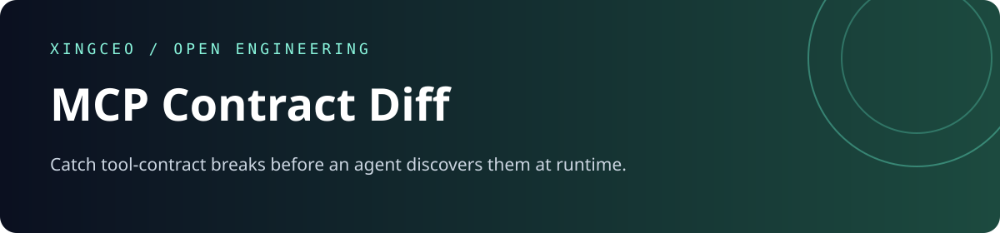
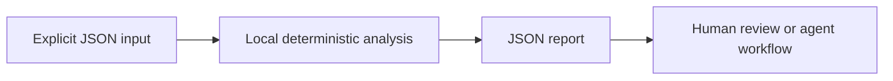

<div align="center">



[](https://github.com/XingCEO/mcp-contract-diff/actions/workflows/ci.yml)

[](LICENSE)


**Catch tool-contract breaks before an agent discovers them at runtime.**

[Try it](#quickstart) · [Input contract](#input-contract) · [Example report](examples/output.json) · [Contribute](CONTRIBUTING.md)

</div>

## The problem

An agent can keep calling a tool after its required arguments, allowed values or output shape change. Reviewing a large tools/list response by eye makes these changes easy to miss.

## How it works

Compare two recorded MCP tool catalogs. Input schemas are checked for newly required fields, removed properties, type changes and narrowed enums. Output schemas reverse the required-field direction. Nested objects and array items are traversed, and unsupported schema-keyword changes are surfaced for manual review. Reports include JSON Pointer locations suitable for CI annotations.



## Quickstart

Requires Python 3.11 or later. The analyzer has **no runtime dependencies**, makes no network requests and runs no shell commands. Domain-specific interpretation (such as SQL rehearsal) is described below.

```bash
git clone https://github.com/XingCEO/mcp-contract-diff.git
cd mcp-contract-diff
python3 -m mcp_contract_diff examples/input.json
```

Optional installation into an isolated environment:

```bash
python3 -m venv .venv
. .venv/bin/activate
python -m pip install .
mcp-contract-diff examples/input.json
```

The package is installed from this checkout; no PyPI publication is claimed.

## Input contract

Use [the complete example](examples/input.json) as a starting point. Paths and strings in JSON are data unless the contract explicitly says they refer to local files.

| Field | Meaning |
| --- | --- |
| `before / after` | Objects with a `tools` array, using MCP tool names and inputSchema/outputSchema. |

## Example result

Generated by running the committed example:

```json
{
  "added_tools": [],
  "breaking": 1,
  "findings": [
    {
      "detail": "Input now requires region",
      "path": "/inputSchema/required",
      "severity": "breaking",
      "tool": "search"
    }
  ]
}
```

## Use from another tool

```python
import json
from mcp_contract_diff import analyze

with open("examples/input.json", encoding="utf-8") as stream:
    report = analyze(json.load(stream))
```

`analyze(data)` returns a JSON-serializable dictionary. The CLI accepts `-` for stdin, writes reports to stdout and input errors to stderr. Exit `0` means analysis completed, including reports containing findings; exit `2` means invalid input or an unreadable file. Gate CI on the report's documented fields, rather than assuming exit `0` means no findings. The JSON report is a v0.1 interface and may evolve before 1.0.

## Validation

```bash
python3 -m unittest discover -v
```

Tests cover the example, malformed CLI input, and the domain-specific boundary cases in [tests/test_core.py](tests/test_core.py). CI also installs the package and runs its console entry point on Python 3.11 and 3.13. Test success demonstrates these cases; it is not evidence of production deployment.

## Scope and limits

Accepts recorded JSON catalogs, not live MCP endpoints. This is a conservative structural comparison, not a full JSON Schema subsumption solver. `$ref`, composition and numeric/string constraints are flagged for review when changed. Tool descriptions are intentionally ignored.

This is a focused experimental first release. Review findings before changing production systems. Inputs and reports may contain your own source or metadata; keep them in an appropriate local workspace.

## Related work and references

- [MCP tool schema](https://modelcontextprotocol.io/specification/2025-06-18/server/tools)
- [JSON Schema](https://json-schema.org/)

These projects and specifications inform the problem space. This repository is an independent implementation; it does not claim to replace the referenced systems or to have invented the underlying techniques.

## Contributing

A small real-world fixture with expected behavior is the most useful contribution. See [CONTRIBUTING.md](CONTRIBUTING.md). Please remove private data before filing an issue.

## License

[MIT](LICENSE) © 2026 XingCEO.
